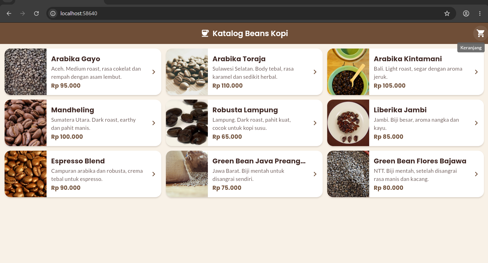
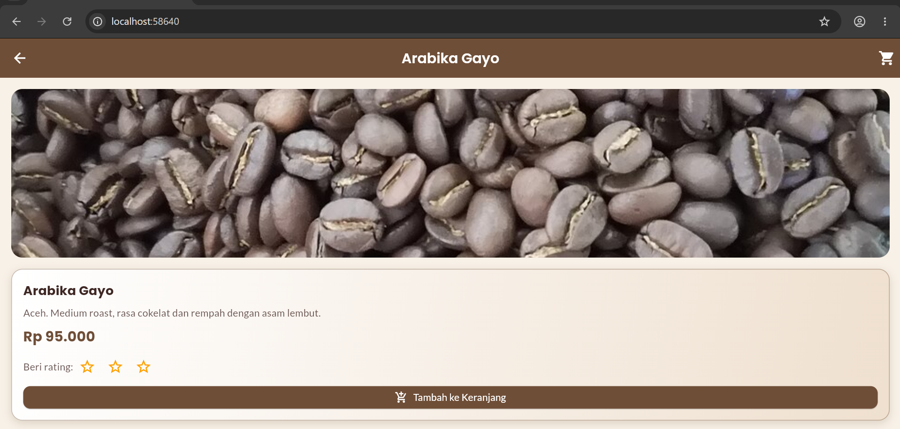
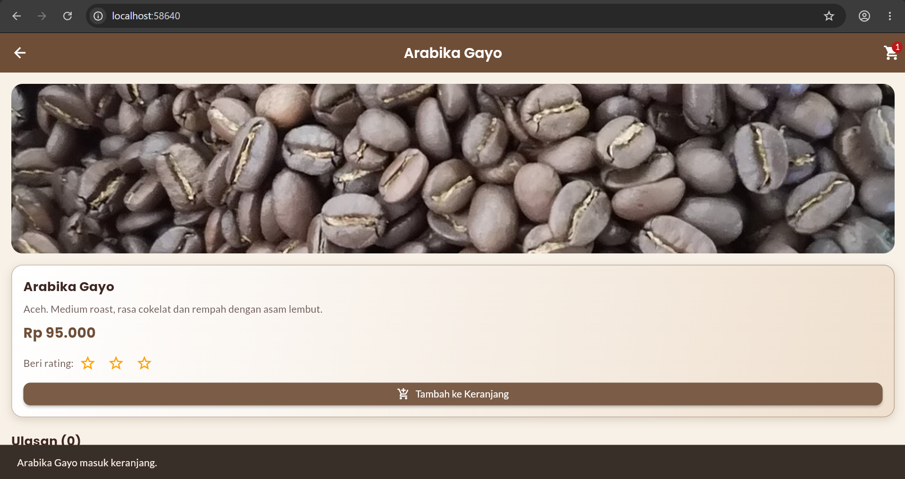
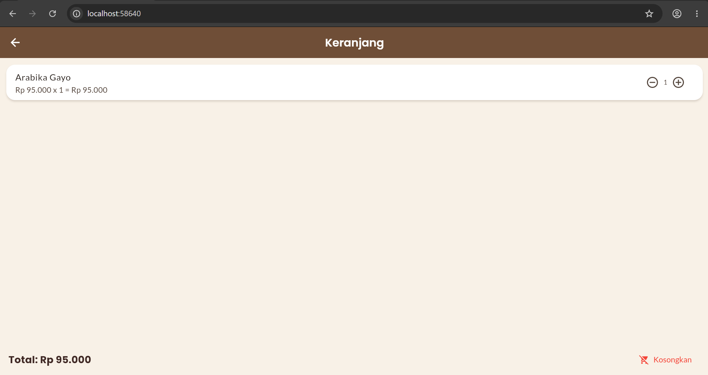

# Dokumentasi: Keranjang Belanja dengan Provider

Fitur **Keranjang Belanja** pada aplikasi *Katalog Beans Kopi*, dibuat untuk menerapkan materi
**State Management di Flutter dengan Provider** (`9_State-management-di-Flutter-dengan-Provider.pdf`).

## Daftar Isi

1. [Ringkasan Fitur](#1-ringkasan-fitur)
2. [Mengapa Keranjang Memakai Provider?](#2-mengapa-keranjang-memakai-provider)
3. [Arsitektur](#3-arsitektur)
4. [Langkah Implementasi](#4-langkah-implementasi)
5. [Consumer, watch, dan read](#5-consumer-watch-dan-read)
6. [Tampilan Aplikasi](#6-tampilan-aplikasi)
7. [Pengujian](#7-pengujian)
8. [Cara Menjalankan](#8-cara-menjalankan)
9. [Batasan](#9-batasan)

---

## 1. Ringkasan Fitur

| No | Fitur | Lokasi |
|----|-------|--------|
| K1 | Ikon keranjang dengan **badge** jumlah item | AppBar Beranda dan Detail |
| K2 | Tombol **Tambah ke Keranjang** + SnackBar konfirmasi | Halaman Detail |
| K3 | Daftar isi keranjang, tombol **−** / **+** per produk | Halaman Keranjang |
| K4 | **Total harga** otomatis | Halaman Keranjang (bagian bawah) |
| K5 | Tombol **Kosongkan** (tugas *Reset* dari slide 17) | Halaman Keranjang |

## 2. Mengapa Keranjang Memakai Provider?

Materi membagi state menjadi dua jenis:

| | Ephemeral state (lokal) | App state (bersama) |
|---|---|---|
| Dipakai oleh | Satu widget | Banyak widget / halaman |
| Alat | `StatefulWidget` + `setState` | Provider |
| Di aplikasi ini | Rating bintang, daftar ulasan | **Keranjang belanja** |

Keranjang dibaca dan diubah dari **tiga tempat**: Beranda (badge), Detail (tombol tambah),
dan halaman Keranjang. Jika memakai `setState`, data harus dioper lewat konstruktor dari halaman
ke halaman (*prop drilling*). Dengan Provider, setiap widget mengambil data langsung dari atas tree.

> Pertanyaan kuncinya: **siapa saja yang perlu membaca atau mengubah state ini?**
> Jika jawabannya lebih dari satu widget, pertimbangkan Provider.

## 3. Arsitektur

```
              ┌─────────────────────────────────┐
              │ KeranjangModel (ChangeNotifier) │  ← MODEL
              │ tambah()  kurangi()  reset()    │
              └────────────────┬────────────────┘
                               │ notifyListeners()
              ┌────────────────▼────────────────┐
              │     ChangeNotifierProvider      │  ← PENYEDIA (di main())
              └────────────────┬────────────────┘
                               │ akses lewat context
       ┌───────────────────────┼───────────────────────┐
       ▼                       ▼                       ▼
┌─────────────────┐   ┌─────────────────┐   ┌─────────────────┐
│ TombolKeranjang │   │ DetailPage      │   │ KeranjangPage   │
│ Consumer        │   │ context.read    │   │ context.watch   │
│ (badge angka)   │   │ (Tambah)        │   │ + context.read  │
└─────────────────┘   └─────────────────┘   └─────────────────┘
                ← semuanya PENDENGAR / pemakai model →
```

### File yang terlibat

| File | Peran |
|------|-------|
| `lib/keranjang_model.dart` | **Baru.** Model `KeranjangModel` |
| `lib/main.dart` | Provider di `main()`, `TombolKeranjang`, tombol di `DetailPage`, `KeranjangPage` |
| `lib/product.dart` | Fungsi `rupiah()` dipisah agar bisa dipakai untuk total |
| `pubspec.yaml` | Dependensi `provider: ^6.1.5+1` |
| `test/keranjang_test.dart` | **Baru.** Test model dan alur keranjang |

## 4. Langkah Implementasi

### Persiapan: pasang Provider

```bash
flutter pub add provider
```

Perintah ini menambahkan ke `pubspec.yaml`:

```yaml
dependencies:
  provider: ^6.1.5+1
```

### Langkah 1: Buat model (`lib/keranjang_model.dart`)

```dart
class KeranjangModel extends ChangeNotifier {
  final Map<Product, int> _isi = {}; // produk -> jumlah bungkus

  Map<Product, int> get isi => Map.unmodifiable(_isi);
  int get jumlahItem => _isi.values.fold(0, (a, b) => a + b);
  int get totalHarga =>
      _isi.entries.fold(0, (total, e) => total + e.key.price * e.value);

  void tambah(Product p) {
    _isi[p] = (_isi[p] ?? 0) + 1;
    notifyListeners();
  }

  void kurangi(Product p) { /* jumlah 1 -> produk dihapus */ notifyListeners(); }

  void reset() {
    _isi.clear();
    notifyListeners();
  }
}
```

Poin penting:
- Data disimpan **privat** (`_isi`). Dari luar hanya bisa dibaca lewat getter `isi` (tidak bisa diubah).
- Setiap perubahan **wajib** diakhiri `notifyListeners()`. Tanpa itu, UI tidak ikut berubah.
- `jumlahItem` dan `totalHarga` dihitung dari `_isi`, jadi selalu konsisten.

### Langkah 2: Daftarkan di root (`lib/main.dart`)

```dart
void main() {
  runApp(
    ChangeNotifierProvider(
      create: (context) => KeranjangModel(),
      child: const KatalogKuApp(),
    ),
  );
}
```

Provider dipasang paling atas karena **semua halaman** membutuhkan keranjang.
`ChangeNotifierProvider` juga otomatis memanggil `dispose()` pada model saat tidak dipakai lagi.

### Langkah 3: Hubungkan ke UI

**a. Badge di ikon keranjang (`Consumer`)**

```dart
icon: Consumer<KeranjangModel>(
  builder: (context, keranjang, child) => Badge(
    isLabelVisible: keranjang.jumlahItem > 0,
    label: Text('${keranjang.jumlahItem}'),
    child: child,                     // ikon statis, tidak di-rebuild
  ),
  child: const Icon(Icons.shopping_cart),
),
```

**b. Tombol Tambah di Detail (`context.read`)**

```dart
onPressed: () {
  context.read<KeranjangModel>().tambah(product);
  ScaffoldMessenger.of(context)
    ..hideCurrentSnackBar()
    ..showSnackBar(SnackBar(content: Text('${product.name} masuk keranjang.')));
},
```

**c. Halaman Keranjang (`context.watch` + `context.read`)**

```dart
final keranjang = context.watch<KeranjangModel>(); // rebuild saat berubah
...
onPressed: () => context.read<KeranjangModel>().kurangi(e.key),
onPressed: () => context.read<KeranjangModel>().reset(),
```

## 5. Consumer, watch, dan read

| Cara | Mendengarkan? | Yang di-rebuild | Dipakai di |
|------|:---:|---|---|
| `Consumer<T>` | Ya | Hanya isi `builder` | Badge di `TombolKeranjang` |
| `context.watch<T>()` | Ya | Seluruh `build()` widget | `KeranjangPage` (daftar + total) |
| `context.read<T>()` | Tidak | Tidak ada | Tombol Tambah, −, +, Kosongkan |

Aturan praktis:
- Di dalam `onPressed` **selalu** pakai `read`. Aksi tidak perlu mendengarkan perubahan.
- Letakkan `Consumer` **sedalam mungkin**, dan oper bagian statis lewat parameter `child`.

## 6. Tampilan Aplikasi

### 6.1 Beranda: ikon keranjang di AppBar

Ikon keranjang muncul di kanan atas. Badge belum tampil karena keranjang masih kosong.



### 6.2 Detail: tombol Tambah ke Keranjang

Tombol berada di bawah rating, di dalam kartu detail produk.



### 6.3 Setelah ditambahkan

Badge merah **1** muncul di ikon keranjang, dan SnackBar *"Arabika Gayo masuk keranjang."* tampil di bawah.
Badge berubah tanpa `setState`, karena `Consumer` mendengarkan `notifyListeners()` dari model.



### 6.4 Halaman Keranjang

Berisi nama produk, rincian `harga x jumlah = subtotal`, tombol − / +, total harga, dan tombol **Kosongkan**.



## 7. Pengujian

Salah satu keunggulan Provider adalah **logika terpisah dari UI**, sehingga model bisa diuji
tanpa membangun widget.

| Test | File | Yang diuji |
|------|------|------------|
| Unit test model | `test/keranjang_test.dart` | `tambah`, `kurangi`, `totalHarga`, `reset`, jumlah notifikasi |
| Widget test alur | `test/keranjang_test.dart` | Tambah dari Detail → badge berubah → total di Keranjang → kurangi → kosongkan |
| Test ulasan (lama) | `test/ulasan_flow_test.dart` | Dibungkus `ChangeNotifierProvider` karena Detail sekarang membutuhkan model |

Hasil terakhir:

```
flutter analyze   →  No issues found!
flutter test      →  All tests passed! (5 test)
```

## 8. Cara Menjalankan

```bash
flutter pub get
flutter run -d chrome
flutter test
```

Skenario uji manual:
1. Buka produk, tekan **Tambah ke Keranjang** beberapa kali. Badge bertambah.
2. Kembali ke Beranda. Badge menunjukkan angka yang sama.
3. Buka keranjang, tekan − / +. Subtotal dan total ikut berubah.
4. Tekan **Kosongkan**. Muncul tulisan *"Keranjang masih kosong."* dan badge hilang.

## 9. Batasan

- Isi keranjang hanya disimpan di memori, jadi hilang saat aplikasi ditutup.
- Belum ada checkout atau pembayaran.
